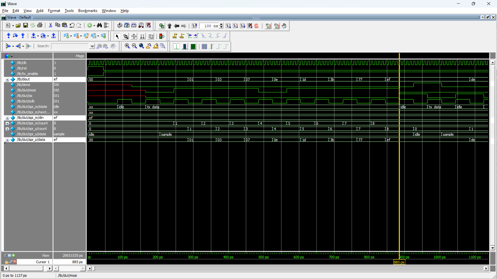

# SPI Master–Slave Communication

## Overview

This project implements Serial Peripheral Interface (SPI) communication using Verilog/SystemVerilog RTL. It focuses on serial data transmission between a master and a slave, with an emphasis on SPI clocking behavior and communication timing.

The project is part of my RTL design practice, aimed at strengthening my understanding of digital design, finite state machines (FSMs), and serial communication protocols.

## Objectives

- Understand SPI master–slave communication.
- Implement serial data transmission using RTL.
- Explore SPI clock polarity (CPOL) and clock phase (CPHA).
- Study the timing and control signals involved in SPI transactions.
- Simulate the design and inspect signal behavior using waveforms.

## Features

- Master-controlled SPI communication.
- Serial data transfer.
- Clock and chip-select control.
- Exploration of SPI Modes 0, 1, 2, and 3.
- RTL simulation and waveform-based debugging.

## Tools Used

- **HDL:** Verilog/SystemVerilog
- **Simulation:** ModelSim
- **Synthesis:** Intel Quartus Prime Lite

## Repository Structure

```text
01_SPI_Master_Slave/
├── rtl/
│   └── <SPI RTL source file>
├── tb/
│   └── <SPI testbench file>
├── Synthesis_M_S.pdf
├── simulation_M-S.png
└── README.md
```

## Project Evidence

### 1. RTL Design — Quartus RTL Viewer

The RTL Viewer diagram shows the master and slave module instances and their signal connections.

[**View Synthesis / RTL Viewer Report**](Synthesis_M_S.pdf)

### 2. Simulation Waveform

The simulation waveform screenshot is provided below to help visualize the SPI communication signals.




## SPI Modes

SPI operation depends on two configuration parameters:

| Mode | CPOL | CPHA |
|---|---:|---:|
| Mode 0 | 0 | 0 |
| Mode 1 | 0 | 1 |
| Mode 2 | 1 | 0 |
| Mode 3 | 1 | 1 |

CPOL determines the idle level of the SPI clock, while CPHA determines which clock edge is used for data sampling.

## Verification

The design is intended to be evaluated through RTL simulation and waveform inspection. Verification results should be documented here after confirming the testbench behavior for each supported SPI mode.

## Synthesis

The RTL can be analyzed and synthesized using Intel Quartus Prime Lite. Add the actual synthesis results after confirming the corresponding project report.

## Learning Outcomes

- SPI protocol fundamentals.
- RTL coding and FSM-based control.
- Serial data transmission and timing.
- Simulation-based debugging.
- Introduction to FPGA synthesis workflows.

## Author

**Rushikesh Dandgawhal**

Electronics and Telecommunication Engineering | RTL Design and VLSI

- GitHub: [Rushikesh-Dandgawhal](https://github.com/Rushikesh-Dandgawhal)

---

*This project is intended for educational and RTL design portfolio purposes.*
