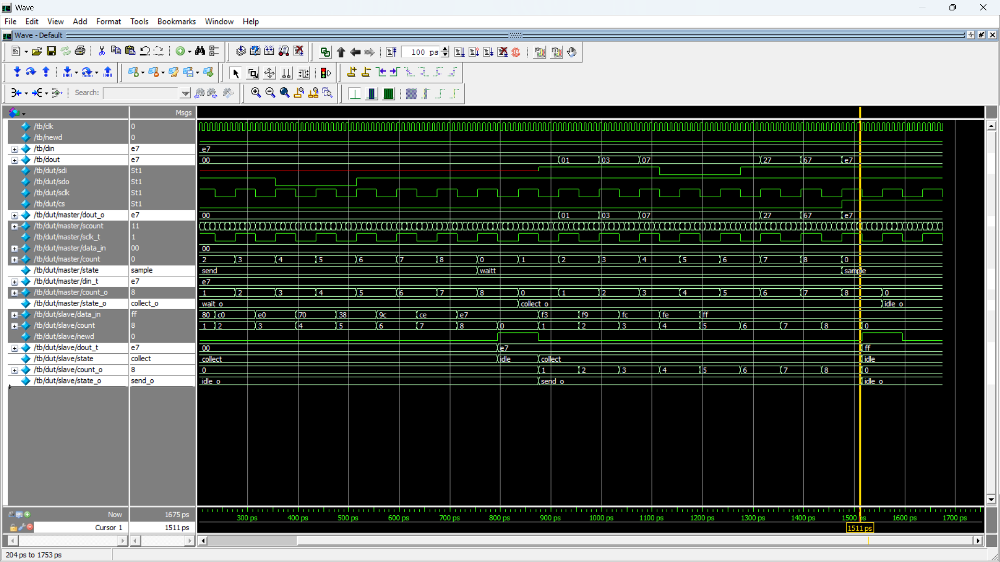

# SPI Master–Slave Design in Verilog

## Overview

This project implements a Serial Peripheral Interface (SPI) master and slave using Verilog/SystemVerilog RTL. The master generates the serial clock (`sclk`), controls the chip-select signal (`cs`), transmits 8-bit data serially, and receives serial data from the slave.

The design integrates the master and slave through a top-level module named `daisy_c`.

## Design Features

- SPI master and slave RTL modules
- 8-bit serial data transmission and reception
- Serial clock generation using a clock divider
- Chip-select control during communication
- Finite State Machine (FSM)-based transmit and receive logic
- Simulation-based functional inspection
- Quartus Prime synthesis and RTL analysis

## RTL Architecture

The design contains three modules:

| Module | Description |
|---|---|
| `spi_m` | Generates the SPI clock and handles master-side transmission and reception |
| `spi_s` | Receives serial data and transmits serial data back to the master |
| `daisy_c` | Top-level module connecting the SPI master and slave |

## Tools Used

- **HDL:** Verilog/SystemVerilog
- **Simulation:** ModelSim Intel FPGA Edition
- **Synthesis:** Intel Quartus Prime Lite
- **Target device:** Intel Cyclone V `5CGXFC7C7F23C8`

## Repository Structure

```text
01_SPI_Master_Slave/
├── rtl/
│   └── SPI_Master_Slave.sv
├── tb/
│   └── daisy_c_tb.sv
├── Simulation_Daisy_c.png
├── Synthesi_Dasiy_Chain.pdf
└── README.md
```

*Adjust the RTL filename in this structure if your actual source file has a different name.*

## Simulation Evidence

The design is evaluated in ModelSim by applying 8-bit input data and observing the serial communication signals and received output.

### Simulation Waveform



The waveform can be used to inspect the clock, chip-select, serial data, and received output during communication.

## Synthesis Report

The design was analyzed using Intel Quartus Prime Lite for RTL synthesis and implementation analysis.

[**View Synthesis Report (PDF)**](Synthesi_Dasiy_Chain.pdf)

## Learning Outcomes

- Understanding SPI master–slave communication
- Implementing serial data transfer using RTL
- Using finite state machines for communication control
- Generating and inspecting serial clock signals
- Simulating RTL designs in ModelSim
- Reviewing synthesis results in Quartus Prime

## Author

Rushikesh Dandgawhal

[GitHub Profile](https://github.com/Rushikesh-Dandgawhal)
